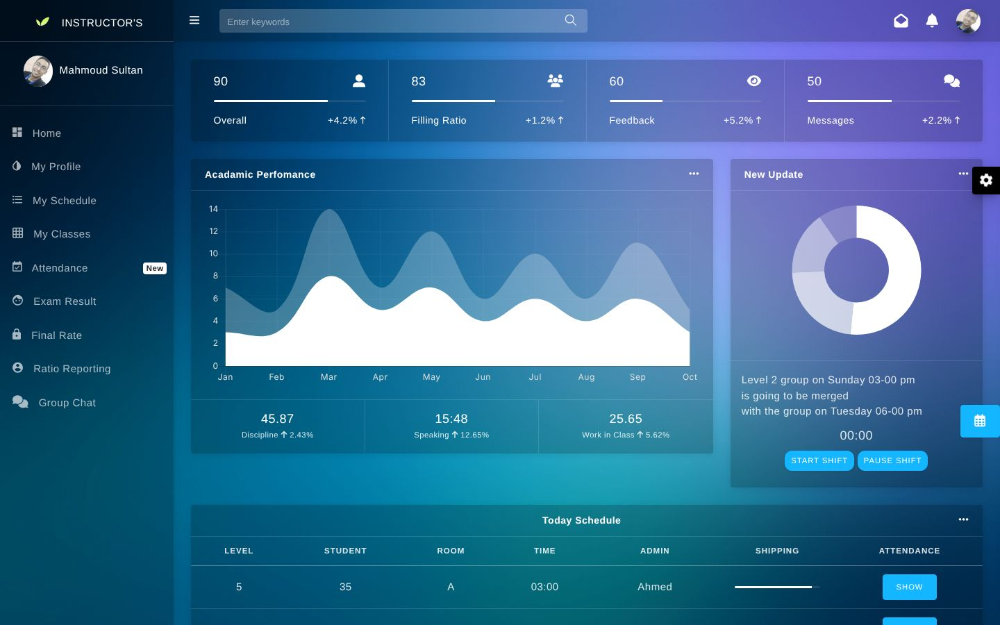
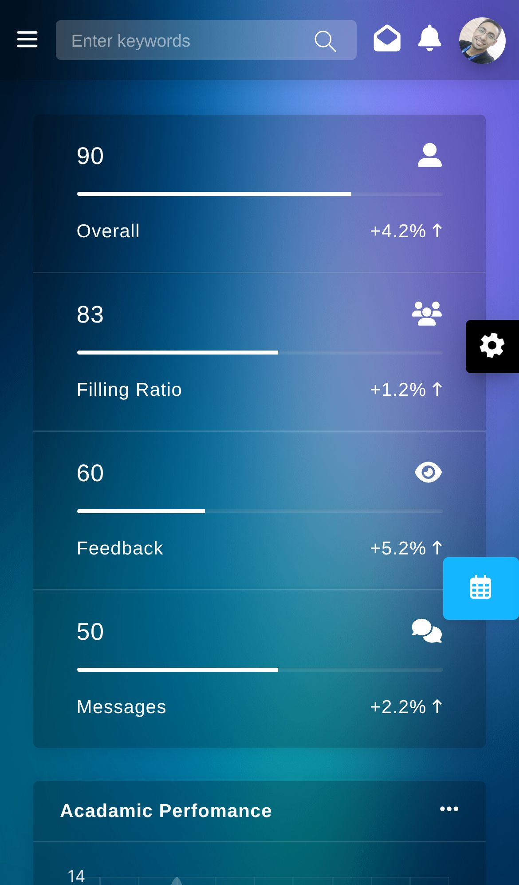
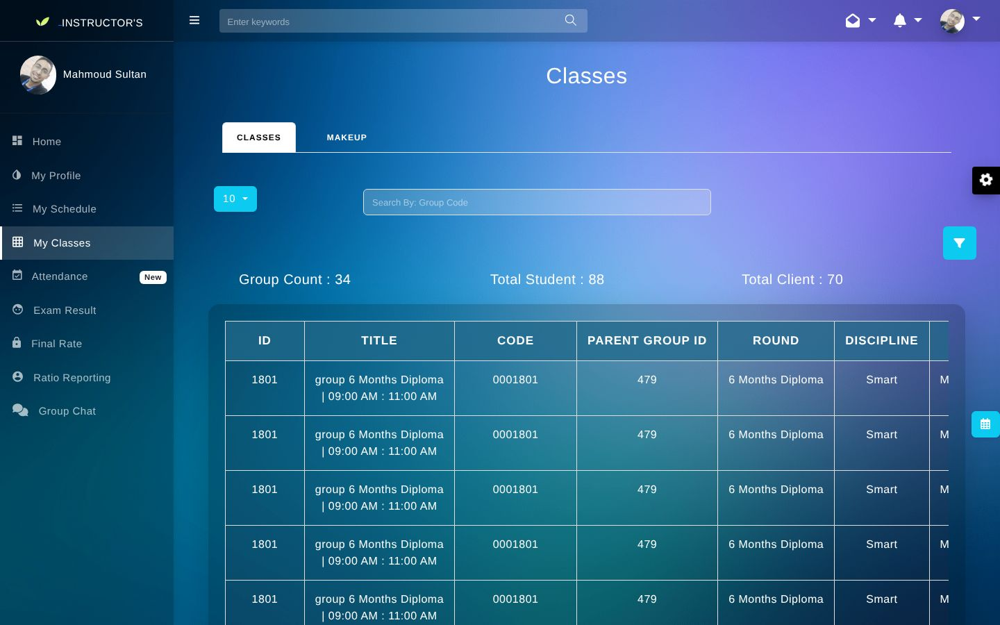
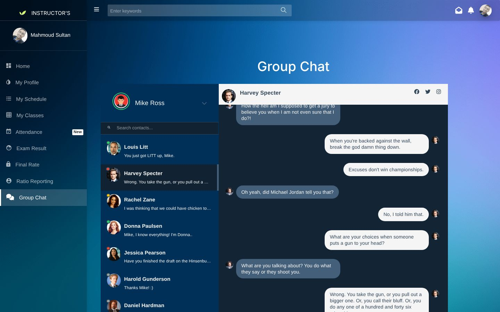

<div align="center">

# Harvest Instructor Portal

### Front-end UI for an instructor dashboard: classes, attendance, exams, monitoring and chat

A multi-page Bootstrap admin UI that lets an English-language instructor see their schedule, classes, attendance, exam results, monitoring sheets and group chat. Static HTML pages with sample data, ready to be wired to a back-end API.

[](https://developer.mozilla.org/docs/Web/HTML)
[](https://developer.mozilla.org/docs/Web/CSS)
[](https://developer.mozilla.org/docs/Web/JavaScript)
[](https://getbootstrap.com)
[](https://jquery.com)
[](https://www.chartjs.org)
<br>
[](https://eslamraafat1.github.io/instructor-Portal/)

**[Live demo](https://eslamraafat1.github.io/instructor-Portal/)** ·
**[Portfolio](https://new-portfolio-ashy-xi.vercel.app/)** ·
**[LinkedIn](https://www.linkedin.com/in/eslamraafat-dev/)** ·
**[Email](mailto:eslamraafat736@gmail.com)**

<br>



</div>

<table>
  <tr>
    <td width="33%"></td>
    <td width="67%">
      <br><br>
      <br>
    </td>
  </tr>
  <tr>
    <td align="center"><sub>Mobile (iPhone 13)</sub></td>
    <td align="center"><sub>My Classes · Group Chat</sub></td>
  </tr>
</table>

---

## Contents

- [Overview](#overview)
- [Features](#features)
- [Pages](#pages)
- [Tech stack](#tech-stack)
- [Project structure](#project-structure)
- [Getting started](#getting-started)
- [Deployment](#deployment)
- [Author](#author)

## Overview

I built this instructor portal UI during my time as a front-end developer at **Harvest British College** (2023). It is a **front-end prototype**: every page is static HTML with sample data (names, numbers and chat messages are placeholders), so the back-end team could connect real data later.

The layout is built on top of the **Dashtreme Bootstrap 4 admin template by Codervent** (its documentation is in [`documentation/`](documentation/)). My work was the portal itself: the instructor-specific pages, tables, forms, the monitoring sheets and the chat screens.

## Features

- **Dashboard** with KPI cards, an academic-performance chart (Chart.js), a donut chart, today's schedule table and a **start / pause shift timer**.
- **Sidebar navigation** with a collapsible menu and a top bar with search, messages, notifications and a profile menu.
- **Theme switcher** (from the template) with several gradient backgrounds.
- **Classes and groups**: class tables with tabs (Classes / Makeup), a search box, totals and detail pages for a group, its sessions and its students.
- **Attendance** pages and a **calendar** view (FullCalendar).
- **Exam results** list, plus view and edit forms for a student's results.
- **Monitoring sheets**: list, create, edit and show pages for lesson-observation forms.
- **Reports**: ratio report and a technical tracker.
- **Profile** page with emergency contact and vacation / leave credit.
- **Group chat** UI with a contact list and a conversation view.
- **Auth screens**: login and register pages.
- Responsive layout: the sidebar collapses on mobile.

## Pages

| Page | File |
| --- | --- |
| Dashboard | `index.html` |
| My Profile | `profile.html` |
| My Schedule | `forms.html` |
| My Classes | `tables.html` · `groups.html` · `Details.html` · `ClassSessions.html` · `GroupStudents.html` · `show.html` |
| Attendance | `calendar.html` · `Attand.html` · `celnderr.html` |
| Exam Results | `icon.html` · `ExamsResults.html` · `EditExamsResults.html` |
| Final Rate | `logiin.html` |
| Ratio Reporting | `ratio.html` |
| Monitoring | `Monitoring.html` · `MonitoringCreate.html` · `MonitoringEdit.html` · `MonitoringShow.html` |
| Technical Tracker | `TechnicalTracker.html` |
| Group Chat | `textChat.html` · `textchat2.html` · `Chat.html` |
| Login / Register | `login.html` · `register.html` |

## Tech stack

| Layer | Tools |
| --- | --- |
| Base template | Dashtreme (Bootstrap 4 admin template, Codervent) |
| Markup and styles | HTML5, CSS3, Bootstrap 4.3 (some pages also load Bootstrap 5 from a CDN) |
| Scripting | JavaScript, jQuery |
| Charts | Chart.js 2.7 |
| Calendar | FullCalendar |
| Icons | Font Awesome, Material Design Iconic Font |
| Hosting | GitHub Pages |

## Project structure

```text
.
├── index.html             # instructor dashboard
├── *.html                 # one file per portal page (see Pages)
├── assets/
│   ├── css/               # Bootstrap, template styles, sidebar, icons
│   ├── js/                # jQuery, Bootstrap, sidebar, app + dashboard scripts
│   ├── plugins/           # Chart.js, FullCalendar, simplebar and other template plugins
│   ├── images/  fonts/  flags/
├── documentation/         # Dashtreme template documentation
└── docs/screenshots/      # README images
```

## Getting started

No build step is needed.

```bash
git clone https://github.com/Eslamraafat1/instructor-Portal.git
cd instructor-Portal
npx serve .        # then open http://localhost:3000
```

## Deployment

The site is deployed on **GitHub Pages** from the `master` branch: <https://eslamraafat1.github.io/instructor-Portal/>

## Author

**Eslam Raafat** — Front-End Developer (React · Next.js · TypeScript)

- **Portfolio:** [new-portfolio-ashy-xi.vercel.app](https://new-portfolio-ashy-xi.vercel.app/)
- **LinkedIn:** [linkedin.com/in/eslamraafat-dev](https://www.linkedin.com/in/eslamraafat-dev/)
- **GitHub:** [@Eslamraafat1](https://github.com/Eslamraafat1)
- **Email:** [eslamraafat736@gmail.com](mailto:eslamraafat736@gmail.com)

---

© Harvest British College. Code shared for portfolio purposes. The Dashtreme template belongs to Codervent.
